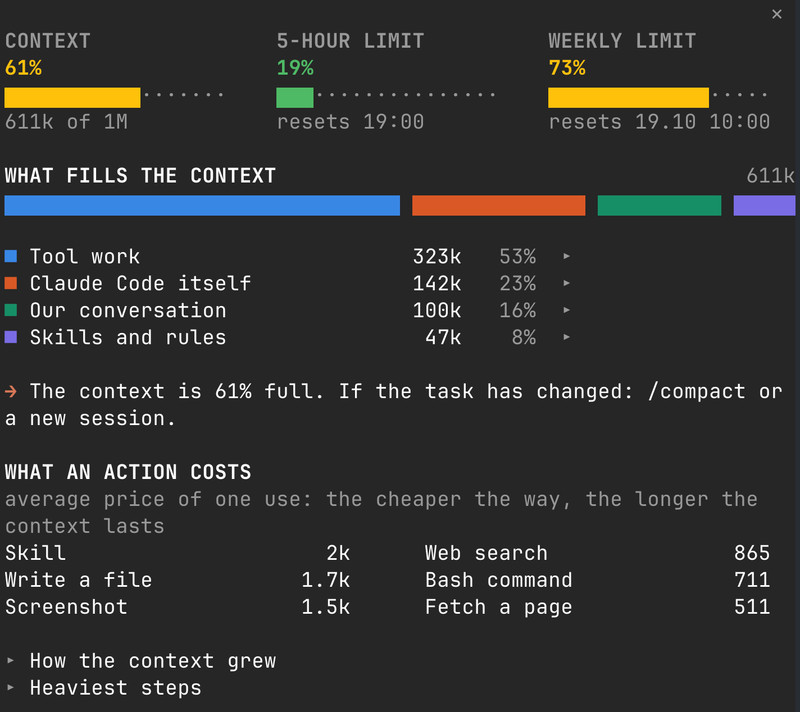
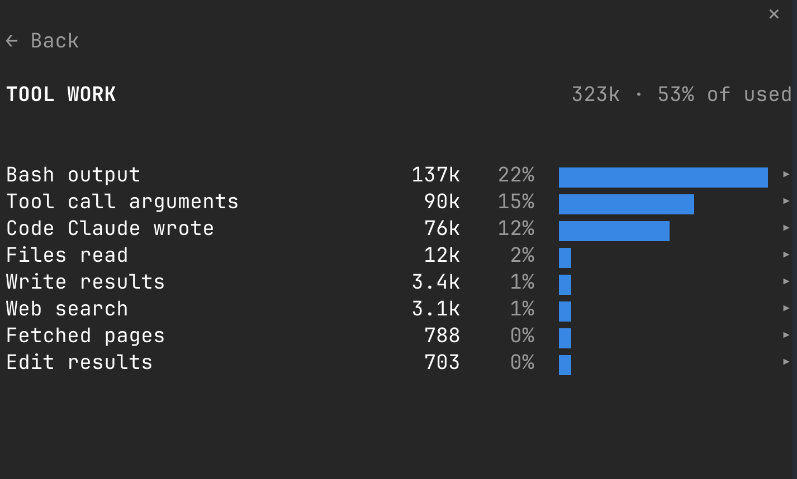
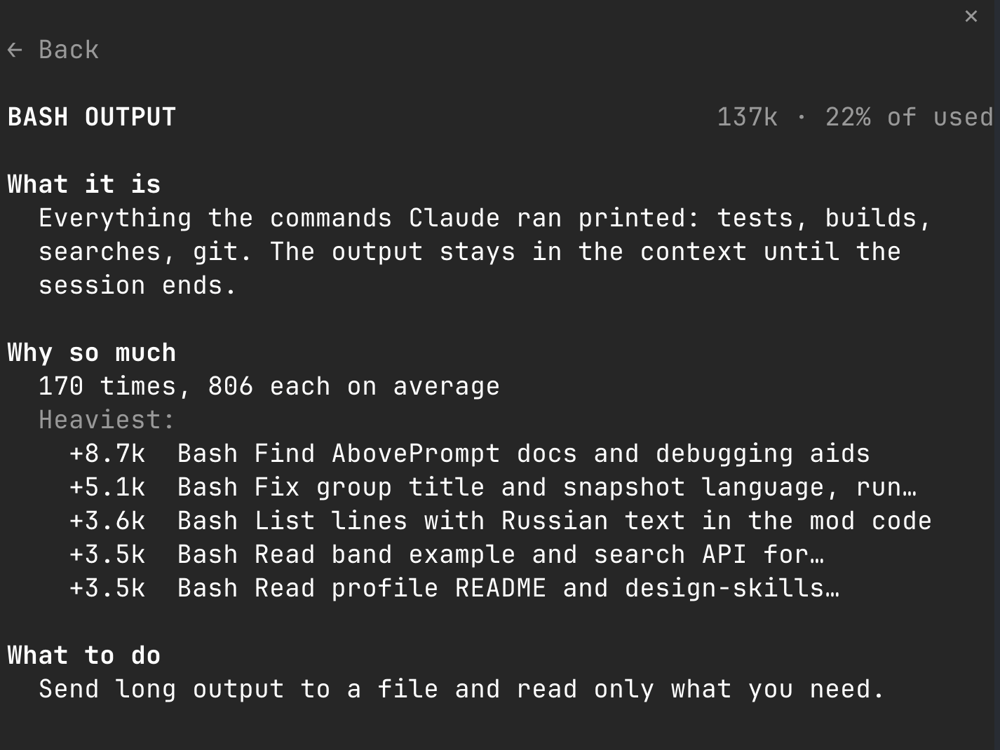

<p align="center">
  <picture>
    <source media="(prefers-color-scheme: dark)" srcset="assets/banner-dark.svg">
    
  </picture>
</p>

<p align="center">
  <a href="#-install"></a>
  <a href="#-limits"></a>
  <a href="LICENSE"></a>
</p>

**A side panel for Claude Code that shows where your context goes.** Type `/ctx`, and a panel
opens next to the chat: how full the context is, how much of your plan limits is left, what fills
the window, and what each kind of action costs.

I made it to learn how context works. `/context` gives a table of categories, and in a long
session most of the window sits in one line called Messages. That line doesn't tell you whether it was the screenshots,
the test output or the files Claude rewrote. The panel splits it open, and next to every item says
in plain words what it is, why it's that big, and what you can do about it.

[Русская версия](README.ru.md)

## 👀 What you see



From top to bottom:

- **Context, 5-hour limit, weekly limit.** Three meters, green, yellow or red. Under the context
  meter, roughly how many turns are left before auto-compaction at the current pace.
- **What fills the context.** One bar for the whole window, split into four groups: tool work,
  Claude Code itself, your conversation, skills and rules. Click a group to open it.
- **A hint.** One line, only when there is something to do. "The context is 55% full. If the task
  has changed: /compact or a new session."
- **What an action costs.** The average price of one screenshot, one file written, one Bash command,
  one skill. This is the part that teaches: you see which habits are expensive.
- **This session.** Everything the model has read across all requests, how much of it came from
  cache, what Claude wrote, how many requests and compactions there were. Compactions don't reset it.
- **How the context grew** and **Heaviest steps**, folded. A chart per turn with the biggest jumps
  and every compaction, and the tool calls that brought in the most.

Click a group to see its items, click an item to get its help page:

| A group | An item |
|---|---|
|  |  |

The panel speaks English unless Claude Code's `language` setting is Russian.

## 📦 Install

You need Claude Code with mods. I built and tested it on Claude Code 2.1.300 in a terminal.

```
/plugin marketplace add schudarin/chudarin-design-skills
/plugin install chudarin-context-mod@chudarin
```

The first line adds my plugin catalog, `chudarin`. It also lists a design agent for Figma; you
don't have to install it, the two are separate. Restart Claude Code after installing, then type
`/ctx`.

## 🕹️ Using it

| Command | What it does |
|---|---|
| `/ctx` | Opens the panel. Again, or Esc while the panel has focus, closes it |
| `/ctx-line` | Turns on a one-line summary above the prompt. Off by default |

Click a row to open it, `← Back` to return. If clicks don't land, focus the panel first:
click it or press `ctrl+x tab`.

In a fullscreen terminal wide enough, the panel docks beside the chat. Otherwise it opens above
the prompt.

## 🔢 Where the numbers come from

- **Categories** are the ones `/context` shows, from Claude Code's own estimate.
- **Messages** are split by reading the conversation: tool results by tool, code Claude wrote,
  tool arguments, reminders Claude Code adds, loaded skills, your messages, Claude's replies,
  images. The split is estimated at about 4 characters per token, then scaled so the parts add up
  to the Messages total from `/context`.
- **Images** count as 1.5k each. The conversation doesn't carry their size, so this is a guess.
- **This session** adds up the token counts the API reports for every request. These are exact.
  The log is kept per session, survives a restart and `--resume`, and holds the last 30 sessions.
  It starts when the mod is installed; earlier history isn't counted.
- **Limits** come from your plan's rate-limit windows. With an API key there are none, and the
  limit meters don't show.

Nothing leaves your machine. The mod makes no network calls.

## ⚠️ Limits

- Mods are an early-access part of Claude Code. An update can change the API and break the panel
  until I fix it.
- Tested in a terminal on macOS. The desktop app is covered by tests only; VS Code and mobile
  aren't tested.
- Where an organization manages Claude Code, hooks on compaction don't run in plugins a person
  installs. The panel works, but the compaction lines in "This session" stay at zero.

## 🔄 Update and remove

```bash
claude plugin update chudarin-context-mod@chudarin      # newest version, restart to apply
claude plugin uninstall chudarin-context-mod@chudarin   # remove
```

## 🎨 Also by me

[chudarin-design-skills](https://github.com/schudarin/chudarin-design-skills): a design agent
for Figma. A separate plugin in the same catalog.

## 📄 License

MIT, see [`LICENSE`](LICENSE).
