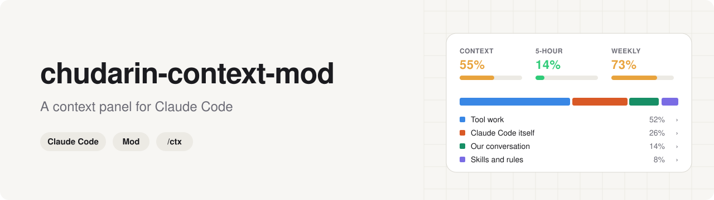
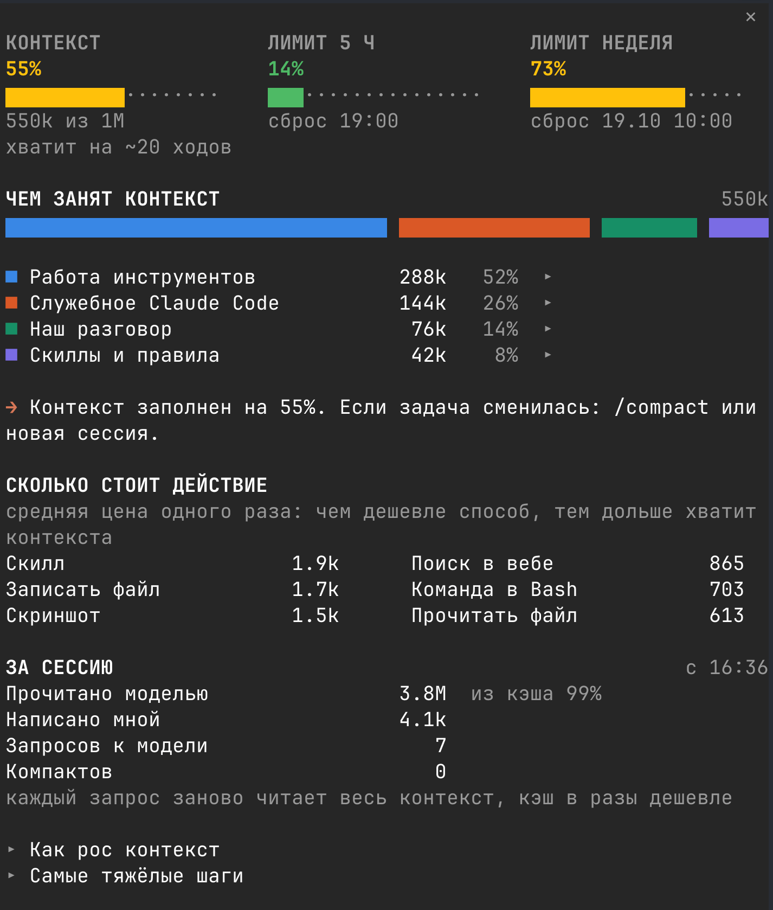
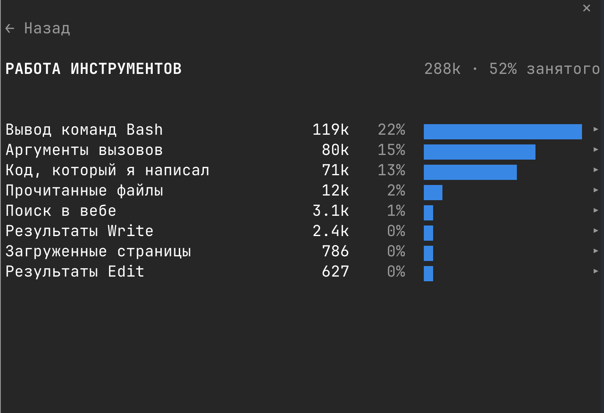
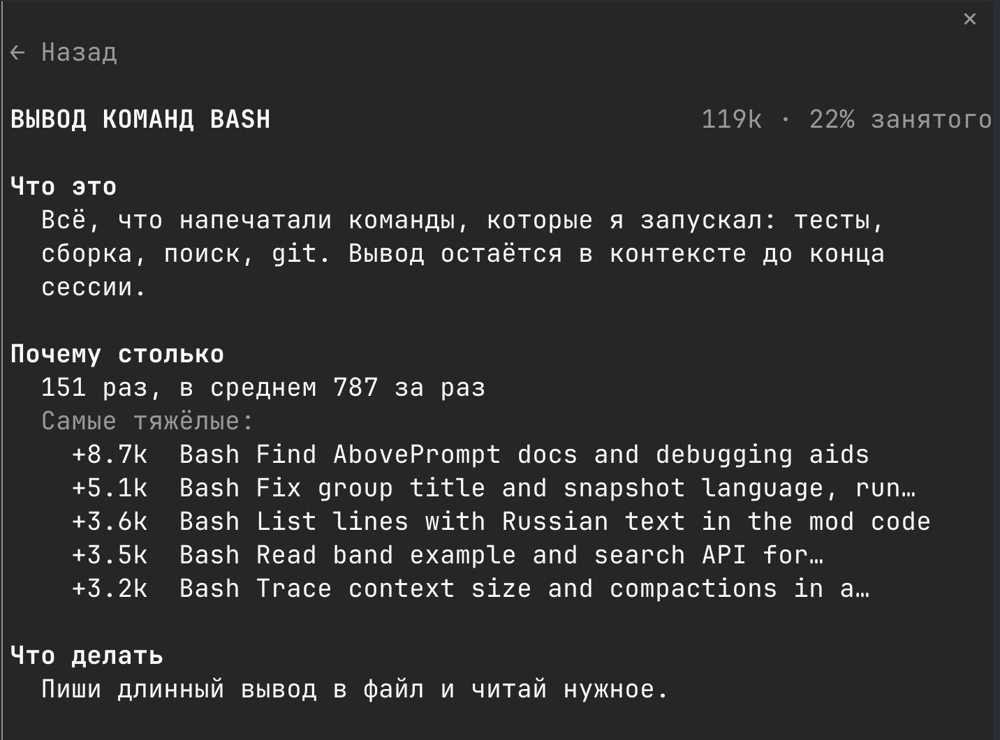

<p align="center">
  <picture>
    <source media="(prefers-color-scheme: dark)" srcset="assets/banner-dark.svg">
    
  </picture>
</p>

<p align="center">
  <a href="#-установка"></a>
  <a href="#-ограничения"></a>
  <a href="LICENSE"></a>
</p>

**Боковая панель для Claude Code, которая показывает, куда уходит контекст.** Набираешь `/ctx`,
и рядом с чатом открывается панель: насколько заполнен контекст, сколько осталось лимитов тарифа,
чем занято окно и сколько стоит каждое действие.

Я сделал её, чтобы разобраться, как устроен контекст. `/context` показывает таблицу категорий,
и в длинной сессии бо́льшая часть окна сидит в одной строке Messages. По ней не понять, что
съело место: скриншоты, вывод тестов или файлы, которые Claude переписал. Панель раскрывает эту
строку и рядом с каждым пунктом объясняет простыми словами, что это, почему столько и что с этим
делать.

[English version](README.md)

## 👀 Что на экране



Сверху вниз:

- **Контекст, лимит на 5 часов, лимит на неделю.** Три шкалы: зелёная, жёлтая или красная. Под
  шкалой контекста примерно сказано, на сколько ходов его хватит до автосжатия при текущем темпе.
- **Чем занят контекст.** Одна полоса на всё окно, разбитая на четыре группы: работа
  инструментов, служебное Claude Code, наш разговор, скиллы и правила. Группа открывается по клику.
- **Подсказка.** Одна строка и только когда есть что делать. «Контекст заполнен на 55%. Если
  задача сменилась: /compact или новая сессия.»
- **Сколько стоит действие.** Средняя цена одного скриншота, одной записи файла, одной команды
  в Bash, одного скилла. На этом и учишься: видно, какие привычки дорогие.
- **За сессию.** Сколько модель прочитала за все запросы, какая доля пришла из кэша, сколько
  написал Claude, сколько было запросов и компактов. Компакт эти цифры не обнуляет.
- **Как рос контекст** и **Самые тяжёлые шаги**, свёрнуты. График по ходам с самыми большими
  скачками и каждым компактом, и вызовы инструментов, которые принесли больше всего.

Клик по группе показывает её пункты, клик по пункту открывает справку:

| Группа | Пункт |
|---|---|
|  |  |

Язык панели берётся из настройки Claude Code `language`: русский, если там Russian, иначе
английский.

## 📦 Установка

Нужен Claude Code с модами. Я собирал и проверял на Claude Code 2.1.300 в терминале.

```
/plugin marketplace add schudarin/chudarin-design-skills
/plugin install chudarin-context-mod@chudarin
```

Первая строка добавляет мой каталог плагинов `chudarin`. В нём есть ещё дизайн-агент для Figma,
ставить его не обязательно: это два отдельных плагина. После установки перезапусти Claude Code
и набери `/ctx`.

## 🕹️ Как пользоваться

| Команда | Что делает |
|---|---|
| `/ctx` | Открывает панель. Повторный `/ctx` или Esc, когда фокус на панели, закрывает её |
| `/ctx-line` | Включает строку-сводку над полем ввода. По умолчанию выключена |

Строки открываются кликом, `← Назад` возвращает. Если клик не срабатывает, сначала переведи
фокус на панель: кликни по ней или нажми `ctrl+x tab`.

В полноэкранном и достаточно широком терминале панель встаёт сбоку от чата, иначе над полем ввода.

## 🔢 Откуда цифры

- **Категории** те же, что в `/context`, по оценке самого Claude Code.
- **Messages** мод раскладывает, читая переписку: результаты инструментов по типам, код, который
  написал Claude, аргументы вызовов, служебные вставки Claude Code, загруженные скиллы, твои
  сообщения, ответы Claude, картинки. Части оцениваются примерно по 4 символа на токен, а потом
  подгоняются, чтобы в сумме совпасть с Messages из `/context`.
- **Картинки** считаются по 1.5k за штуку. Размера картинок в переписке нет, так что это оценка.
- **За сессию** складывает число токенов, которое API сообщает о каждом запросе. Тут цифры точные.
  Журнал ведётся по каждой сессии, переживает перезапуск и `--resume`, хранятся 30 последних
  сессий. Отсчёт идёт с установки мода, более ранняя история не считается.
- **Лимиты** берутся из окон лимитов твоего тарифа. С API-ключом их нет, и шкалы лимитов не
  показываются.

Ничего не уходит с твоей машины: мод не ходит в сеть.

## ⚠️ Ограничения

- Моды в Claude Code пока в раннем доступе. Обновление может поменять API и сломать панель,
  пока я её не починю.
- Проверено в терминале на macOS. Приложение для компьютера покрыто только тестами, VS Code и
  мобильное приложение не проверялись.
- Там, где Claude Code управляет организация, хуки на компакт в плагинах, поставленных самим
  человеком, не срабатывают. Панель работает, но компакты в «За сессию» останутся нулём.

## 🔄 Обновить и удалить

```bash
claude plugin update chudarin-context-mod@chudarin      # новая версия, после этого перезапуск
claude plugin uninstall chudarin-context-mod@chudarin   # удалить
```

## 🎨 Ещё у меня

[chudarin-design-skills](https://github.com/schudarin/chudarin-design-skills): дизайн-агент для
Figma. Отдельный плагин в том же каталоге.

## 📄 Лицензия

MIT, см. [`LICENSE`](LICENSE).
